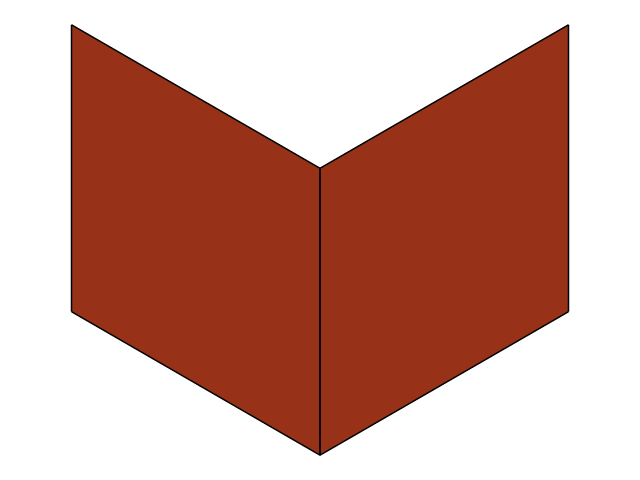
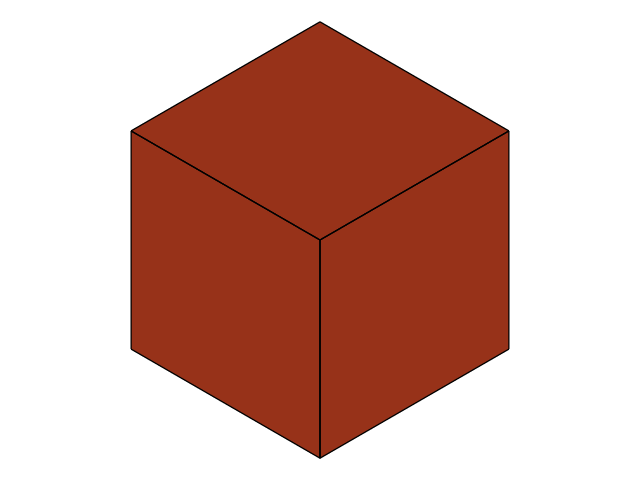
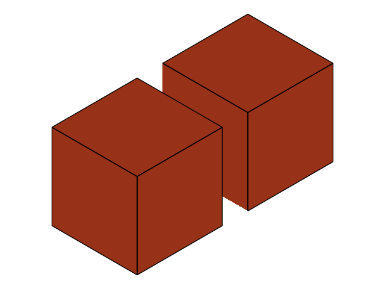
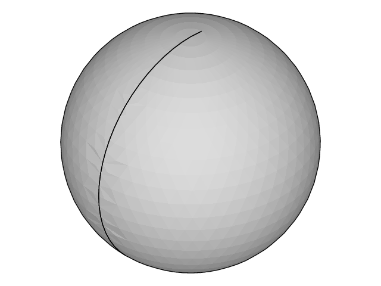

# Native shape foundation and ownership

`Shape` owns native topology. It retains the exact root category and every component, including intentional open shells, loose edges and vertices, and empty compounds. Typed owners `Vertex`, `Wire`, `Shell`, and `Compound` expose the same inspection methods. Converting to `Solid`, `Face`, or `Edge` requires the matching category and never discards other geometry.

The gallery shows the foundation's visible results. Open topology, validation, and tessellation retain their PNG previews from the full feature branch. The copy-history preview uses only foundation APIs, with the copy moved apart using the existing `Solid` translation method for display.

| Foundation item | Preview |
| --- | --- |
| **Open topology and BRep boundaries.** Cube shell with its top face removed. |  |
| **Basic validation.** Validated solid; validation leaves its geometry unchanged. |  |
| **Ownership and copy history.** Source cube and independent copy, separated for display. |  |
| **Native meshing.** Tessellated sphere used for the mesh and UV queries. |  |

The previews are reproducible on this branch. Run `cargo run --example native_features` to regenerate the four PNGs, or append an output directory to write them elsewhere. The example requires the `png` feature, enabled by default, and writes only PNG previews.

Views retain native ownership. Subshape views survive the parent wrapper, while `clone` and `copied` deep-copy topology and geometry. Converting a styled solid expands its whole-solid color onto faces, and copied shapes retain styles through native correspondence. BRep serialization preserves topology and geometry but omits colors, meshes, and operation history.

Open and empty results are valid outcomes. Face extraction and removal preserve disconnected shells and loose topology, and sewing returns the natural output category. `to_solid` accepts exactly one valid closed shell and orients it outward; an open shell remains an error for this conversion.

```rust
use cadrum::{DVec3, Shape, ShapeKind, Solid};

let cube = Solid::cube(DVec3::ZERO, DVec3::splat(10.0));
let shape = Shape::from(&cube);
let faces = shape.faces()?;
let open = shape.remove_faces([&faces[0]], 1e-6)?;
assert_eq!(open.kind(), ShapeKind::Shell);
assert!(open.validate(Some(ShapeKind::Shell))?.valid);
assert!(!open.is_closed()?);
let mut bytes = Vec::new();
open.write_brep(&mut bytes)?;
let restored = Shape::read_brep(&mut bytes.as_slice())?;
assert_eq!(restored.faces()?.len(), 5);
# Ok::<(), cadrum::Error>(())
```

Validation distinguishes geometry from category expectations. `validate` reports native BRepCheck status codes and one-based subshape/context indices, along with validity, closure, emptiness, and category matching. A valid open shell is not a solid, and a category mismatch does not make its geometry invalid.

Operation results carry explicit ancestry. `OperationResult<T>` separates the value, warnings, diagnostics, and `History`; relations distinguish modified, generated, unchanged, removed, and unknown topology. `copied` supplies native copy correspondence and `topology_at` resolves report/history indices while retaining styles. `History::compose` follows descendants through later results and marks missing correspondence as unknown rather than confirmed removal. References are scoped to their original operand/result and are not persistent identifiers across serialization.

Meshing supports native open and empty topology. `mesh` returns disposable triangles and edge polylines, while `tessellate` adds per-vertex UV availability, native status flags, and operation diagnostics. Curve-only scenes render their polylines. Native triangulation is cleaned after tessellation, and invalid deflection parameters are rejected before the kernel call.

Progress controls support cooperative cancellation. `OperationControl` serializes callbacks and catches callback panics before returning across native frames. A control permits one active operation, and concurrent or callback-reentrant reuse fails before native execution. Cancellation tokens can be shared across threads.

Owning wrappers preserve `Send`. Existing `Solid`, `Face`, and `Edge` owners and the new topology owners can move to a worker, remain worker-local, and return results. `Sync` is not implemented. Related native aliases must remain serialized on one worker because native queries and operations can mutate shared geometry and caches; use independent deep copies for concurrent geometry work.

The foundation adds no dependencies or native libraries. Existing modeling signatures and numbered example programs are retained. The new `Error::Shape`, `Error::Operation`, `Error::Unsupported`, and `Error::Cancelled` variants require downstream exhaustive matches to be updated.

The example exercises open topology without generated files. Run `cargo run --example open_shape` to remove one cube face, tessellate the shell, and round-trip it through an in-memory BRep buffer.

Shared access remains restricted at compile time. A `Shape` can be transferred between workers, but cannot be shared as `Sync`.

```compile_fail
fn require_sync<T: Sync>() {}
require_sync::<cadrum::Shape>();
```

